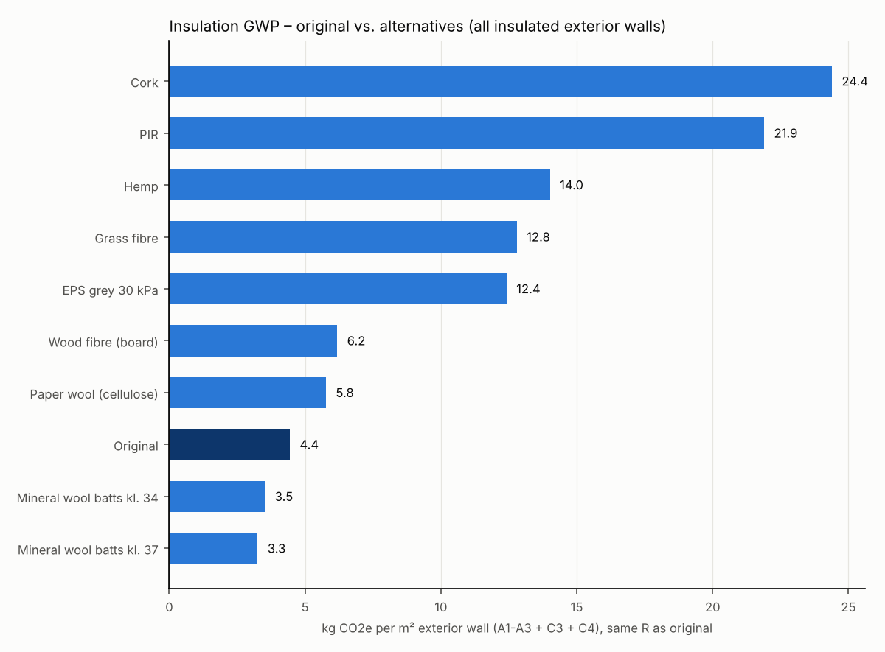

# A4 – Exterior wall insulation tool (Group 35)

## About the tool

**Problem / claim.** Report 2608 (section 5.3, p. 38) states that new materials will be picked
*"with the lowest GWP-output while still satisfying each of the other roles"*. For an exterior
wall the insulation can only be swapped if the thermal performance stays the same, so a fair
comparison has to be made **at equal U-value**, not per kg or per m³. The tool checks the claim
for the insulation of the exterior walls: *which insulation gives the lowest GWP when it is
sized to give the same U-value as the insulation in the model?*

**Where the problem was found.** Advanced Building Design report 2608, and the A2 use case of
group 35. The tool builds on the A3 tool of an earlier group ("Old model"), which linked IFC wall
layers to BR18 Table 7 but compared materials by volume only.

**Description.** The tool reads the IFC model and, for every exterior wall type:

1. extracts the material layers, thicknesses, net area and the U-value stored in the IFC
   (`Pset_WallCommon.ThermalTransmittance`),
2. calculates the U-value with DS/EN ISO 6946 (`U = 1/(Rsi + Σ d/λ + Rse)`) and the thermal
   resistance R and "U-value" (1/R) of the insulation layer(s),
3. links each layer to BR18 Table 7 and calculates GWP (A1-A3 + C3 + C4),
4. replaces the insulation with alternatives (hemp, wood fibre, grass, cork, paper wool, mineral
   wool, EPS, PIR) using the thickness that gives **the same R**: `d_alt = R_ins · λ_alt`,
   so the wall U-value is unchanged, and compares thickness and GWP,
5. reports checks, data gaps and assumptions (console, Excel and a chart).

Example (wall type *M-Exterior-Double Brick (390mm)*, 818 m²): 120 mm rigid mineral wool
(λ = 0.034, R = 3.53 m²K/W, U_ins = 0.283 W/m²K) → **141 mm hemp** (λ = 0.040) gives the same
R. Insulation GWP rises from 4.6 to 8.7 kg CO₂e/m² wall (+3.6 % for the whole wall).



### Structure (Working Together format)

`analyse(model)` in `wall_insulation_tool.py` is the one callable function for the manager:

```python
from wall_insulation_tool import analyse
result = analyse(my_model)        # -> {"walls", "comparison", "gaps", "assumptions"}
```

| File | Type | Functions |
| --- | --- | --- |
| `capt.py` | Capture | `CAPT_EXTERIOR_WALLS`, `CAPT_WALL_TYPES`, `CAPT_LAYERS`, `CAPT_AREA`, `CAPT_UVALUE`, `CAPT_TABLE7` |
| `conn.py` | Connect | `CONN_MATERIAL` (IFC material → rule in config), `CONN_LAMBDA`, `CONN_TABLE7` |
| `calc.py` | Calculate | `CALC_LAYER_R`, `CALC_UVALUE`, `CALC_INSULATION_UVALUE`, `CALC_EQUIVALENT_THICKNESS`, `CALC_QUANTITY`, `CALC_GWP` |
| `chek.py` | Check | `CHEK_UVALUE` (requirement + IFC vs calculated), `CHEK_AREA` |
| `comp.py` | Compare | **`COMP_INSULATION`** – primary function |
| `comm.py` | Communicate | `COMM_CONSOLE`, `COMM_EXCEL`, `COMM_CHART` |
| `wall_insulation_tool.py` | – | `analyse(model)` |
| `main.py` | – | sets `model_path`, runs `analyse` and the COMM functions |
| `input/config.json` | input | λ-values, Table 7 mapping, insulation alternatives, Rsi/Rse, U requirement |
| `input/Tabel-7-2025.xlsx` | input | BR18 Table 7 generic emission data |
| `output/` | output | `wall_insulation_results.xlsx`, `insulation_gwp_comparison.png` |
| `wall_insulation_tool.ids` | IDS | model requirements |

### Instructions to run the tool

1. `pip install ifcopenshell pandas openpyxl matplotlib tabulate`
2. Set `model_path` in `main.py` to the IFC model on your machine (the model is not in the repo).
3. Optional: set `WALL_TYPES` in `main.py` to analyse only some wall types.
4. `python main.py` (or `python wall_insulation_tool.py <model.ifc>`).
5. Results are printed and written to `output/`.
6. To add an insulation alternative or change an assumption, edit `input/config.json`
   (name, λ and Table 7 `Sorterings ID`).

## Advanced Building Design

**Stage.** Mainly **stage B/C** (design / detailed design): the wall build-ups exist in the model
and the material consultant compares insulation options. It can also document the final choice in
stage D.

**Subjects.** Materials (LCA / GWP), Energy/indoor climate (U-values), Architecture (wall
thickness changes when a lower-performing insulation is chosen).

**Information required in the model.**

- `IfcWall` with `Pset_WallCommon.IsExternal = TRUE`
- `IfcMaterialLayerSet(Usage)` with material names and layer thicknesses
- `Qto_WallBaseQuantities.NetSideArea` (or `NetVolume` + `Width`)
- `Pset_WallCommon.ThermalTransmittance` (used for the check against the calculated U-value)
- optional: `ThermalConductivity` on the materials (`Pset_MaterialThermal`) – used before config values
- outside the model: BR18 Table 7 and λ-values (`input/`)

## IDS

`wall_insulation_tool.ids` checks the requirements above. Model 2608: 852 of 863 external walls
pass; the 11 failures are *Generic - 150mm* walls without a U-value.

## Findings, limitations and assumptions

- **U-values in the IFC are not reliable.** They come from Revit's default thermal assets:
  back-calculating shows the air cavity treated as λ ≈ 0.025 W/mK (R ≈ 2.0 m²K/W for 50 mm,
  ISO 6946 gives ≈ 0.18), batt insulation λ ≈ 0.019, and no surface resistances. The tool
  therefore recalculates U per ISO 6946 and flags deviations (e.g. 390 mm double brick:
  U_IFC = 0.171, U_calc = 0.236 W/m²K).
- **Table 7 unit "m² with R=1 m²K/W"**: GWP = area × R × factor. (The old model divided
  volume by thickness, which ignores R.) For these entries the comparison at equal R is
  independent of λ – λ only decides the thickness.
- Bio-based insulation has negative A1-A3 but the stored carbon is released in C3, so with the
  BR18 Table 7 scope (A1-A3 + C3 + C4) hemp, grass and cork end higher than mineral wool.
  Module D is reported separately per layer.
- λ-values in `config.json` are assumed design values (mineral wool: from class, e.g. kl. 37 →
  0.037; bio-based: typical product values) and must be checked against the chosen product.
- The Revit layer *"Structure, Wood Joist/Rafter Layer, Batt Insulation"* is treated as
  mineral wool batts; timber studs (thermal bridges and GWP) are not included.
- Homogeneous layers only (no thermal bridges, no fixings); B4 replacement and operational
  energy are not included.
- U requirement default 0.30 W/m²K (BR18 Bilag 2, tabel 1, exterior walls); 0.18 for renovation
  (Bilag 2, tabel 2) – set in `config.json`.
